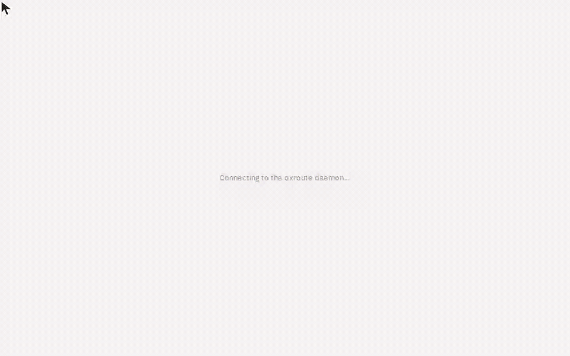

# oxroute

Everything asking for your attention in one inbox, sorted into agents that
do the work while you watch.

*[The video](demo/demo.mp4) opens with selecting code and quoting the diff into
chat, followed by resizable panes, shared terminals, inbox routing, tasks,
and diagrams. Refresh with [demo/run.sh](demo/run.sh).
The inbox take uses [demo/oxroute.oxd](demo/oxroute.oxd); the new feature take
uses the current UI with isolated [fixture data](demo/record-features.mjs).*

The original inbox take can be recorded again with [demo/record-inbox.sh](demo/record-inbox.sh).

| | |
|---|---|
| **Inbox** | Slack, email or anything that can POST waits in one place until you say where it goes |
| **Routing** | Send a request to a new session, to one already running, or throw it away |
| **Fleet** | Every session on one screen, with what it is doing now and what it just said |
| **Panes** | Arrange conversations and terminals, drag shared edges, or collapse a pane to its handle |
| **Terminals** | Agents can open two panes per conversation; access to another terminal requires your consent |
| **Tasks** | A shared list the agents work through: they mark a task done, you approve it or send it back |
| **Corrections** | "Not yet" puts the task above the composer, so what is wrong is said with room and pictures |
| **Diagram** | Draw a change to the architecture diagram and the agent makes the code match it |
| **Drawing** | Mark up a screenshot and hand that to the agent, or file it as work |
| **Search** | Find the session by a line someone said in it, across oxroute's sessions and the harnesses' own |
| **Forks** | Branch a session into this card or one beside it, and merge it back when it is done |
| **Harnesses** | Claude Code and Codex, behind one interface |
| **Surfaces** | A web UI, a terminal UI and Slack, all on the same sessions |
| **Settings** | Light or dark, minimum pane scale, how much of each tool call you see, whether blocked work is drawn, keyboard hints |
| **Change review** | Syntax colors and changed-word highlights; quote diff lines and approve the exact revision before publication |

## Review before publication

The agent commits its proposed change locally, then POSTs to
`/api/agents/<agent-id>/reviews` with `repository` (absolute worktree root),
`base` (existing target branch), `remote`, `title`, and `description`.
Oxroute stores the committed diff and adds a review card to that conversation.
There is no VM repository discovery or push during review.

Open the card to browse files. Additions are green, deletions red. Select lines
and right-click to quote their review ID, fixed commits, file, and line ranges
into a question. The checkmark approves publication of that revision and queues
the authorization to the owning agent without interrupting its current turn.
Approval does not authorize merging or deploying.

Before pushing, the agent must GET `/api/agents/<agent-id>/reviews/<review-id>`
and require `status: approved`. Publish the recorded head commit to the recorded
remote and branch, using the stored PR title and description. Changed commits,
base, branch, destination, or tracked edits make the review stale and require
a new review. Stored diffs survive those changes and restarts.

This is a consent workflow in a single-user app. It does not sandbox an agent's
shell or intercept arbitrary Git commands. Approval is a user action; agents
must never call the approval endpoint themselves.
