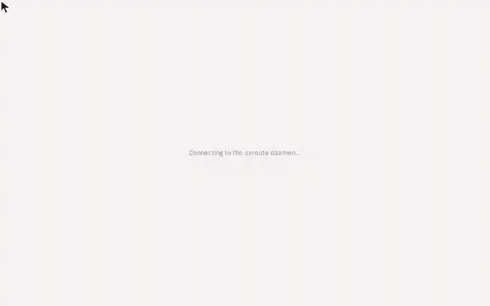

# oxroute

Everything asking for your attention in one inbox, sorted into agents that
do the work while you watch.

[](demo/demo.mp4)

*[The video](demo/demo.mp4) opens with selecting code and quoting the diff into
chat, followed by resizable panes, shared terminals, inbox routing, tasks,
and diagrams. Refresh with [demo/run.sh](demo/run.sh).
The inbox take uses [demo/oxroute.oxd](demo/oxroute.oxd); the new feature take
uses the current UI with isolated [fixture data](demo/record-features.mjs).*

The original inbox take can be recorded again with [demo/record-inbox.sh](demo/record-inbox.sh).

| | |
|---|---|
| **Inbox** | Slack, email or anything that can POST waits in one place until you say where it goes |
| **Routing** | Send a request to a new session, to one already running, or throw it away |
| **Fleet** | Every session on one screen, with what it is doing now and what it just said |
| **Panes** | Arrange conversations and terminals, resize shared edges, or collapse a pane to its handle. Drag handles and tabs between Oxroute windows, onto pane edges, or onto the tab bar; drag outside to detach, or right-click **Move to new window**. Drafts and attachments move with the pane |
| **Terminals** | Agents can open two panes per conversation; access to another terminal requires your consent. **New follow terminal** opens a shared Bash for the active conversation, preserving directory, variables, jobs and unfinished input. Its header toggle switches between agent priority and user priority |
| **Tasks** | A shared list the agents work through: they mark a task done, you approve it or send it back |
| **Corrections** | "Not yet" puts the task above the composer, so what is wrong is said with room and pictures |
| **Diagram** | Draw a change to the architecture diagram and the agent makes the code match it |
| **Drawing** | Mark up a screenshot and hand that to the agent, or file it as work |
| **Search** | Find the session by a line someone said in it, across oxroute's sessions and the harnesses' own |
| **Forks** | Branch a session into this card or one beside it, and merge it back when it is done |
| **Quoted threads** | Select text to open a linked discussion; click its underline to return, then merge or archive it |
| **Harnesses** | Claude Code and Codex, behind one interface |
| **Surfaces** | A web UI, a terminal UI and Slack, all on the same sessions |
| **Settings** | Automatic card titles and tags, subtle or stacked next-action suggestions, light or dark, pane scale, tool-call detail and keyboard hints |
| **Change review** | Syntax colors and changed-word highlights; quote diff lines and approve the exact revision before publication |

Right-click a task's **Approve** button and choose **Approve all subtasks** to
approve that task and every nested subtask, including unfinished tasks and tasks
hidden by search. This is one atomic human sign-off with a note on each changed
task. Ordinary clicks approve only the selected task. Unrelated tasks and
publication approvals are unchanged.

## Slack routing

Ordinary top-level messages in the configured owner's bot DM continue persistent Focus, with answers posted in the main chat. Start a top-level message with literal `- ` to create a separate conversation and thread; the routing prefix is removed from its prompt. Existing thread replies retain their owner. Inbox imports, other users and channels are unaffected; Focus activity initiated locally stays local.

## Card automation

Open the gear icon for two independent server-wide settings:

- **Automatic card titles** starts on. Luna names new cards until you explicitly rename them. Existing titles are preserved because older records do not distinguish chosen titles from generated ones.
- **Automatic card tags** starts off. When enabled, Luna adds topic tags after turns, preserves existing tags and remembers tags you remove. It cannot replace keyed tags such as workflow stages or publication policy.

Metadata uses `gpt-6-luna` by default. An explicit `OXROUTE_TITLE_MODEL` or `[codex].title_model` overrides the helper model. Conversation and routing models keep their existing configuration.

**Next-action layout** is a browser preference in the same settings menu. Suggestions default to subtle inline choices; select **Stacked** for larger choices with descriptions. The Play dropdown independently controls whether next actions are suggested, and its main control governs automatic continuation.

The conversation header's Play menu can follow that global autorun setting or override it **On** or **Off** for that conversation. Off prevents further automatic next-action selections while the current turn finishes and suggestion buttons remain available. Input routing stays independent.

**Learn from choices** starts on. Displayed next-action choices and inbox routing advice learn from your selections and typed or routed alternatives. Silence and automatic continuations are not feedback. Each domain keeps separate versioned guidance; switching learning off retains that guidance. Routing advice appears in the existing destination chooser; automatic delivery and explicit bindings keep their existing behavior.

## Agent CLI

`oxroute-agent` discovers named commands and request flags from
`/api/agent-openapi.json`. The same handler annotations register the daemon's
routes and generate that schema, so the client has no separate endpoint table.
The existing HTTP API and TUI remain available.

```sh
oxroute-agent --agent agent_ID tasks list --filter status=incomplete --fields id,text,status
oxroute-agent --agent agent_ID tasks update --id task_ID --status done --note 'Implemented and tested.'
oxroute-agent --agent agent_ID notes list --filter taskId=task_ID
oxroute-agent --agent agent_ID tags change --set '["stage:testing"]'
oxroute-agent --agent agent_ID reviews show --review review_ID --full true
```

Commands cover tasks, notes, tags, boards, review creation and reading, session
reading, and state. Use generated `--help` for each command. `--agent` binds the
calling session; `OXROUTE_AGENT_ID` can supply it instead. Task lists show that
session's tasks unless `--all` is supplied. `--fields` projects JSON output and
repeatable `--filter field=value` filters returned objects. Dotted fields such as
`snapshot.headCommit` return only that value under the requested dotted key.

Task updates preserve omitted fields, clearing an obsolete blocker when leaving
the blocked state. Human task sign-off and publication approval keep their
existing UI controls and HTTP routes; they are not generated agent approval
commands. `--json` accepts an object or `@path`; `--server` selects the daemon,
and `--schema path` uses an explicitly exported OpenAPI document. The installer
and idle release flow install the client alongside the daemon.

## Review before publication

The agent commits its proposed change locally, then POSTs to
`/api/agents/<agent-id>/reviews` with `repository` (absolute worktree root),
`base` (existing target branch), `remote`, `title`, and `description`.
Oxroute stores the committed diff and adds a review card to that conversation.
There is no VM repository discovery or push during review.

Open the card to browse files. Additions are green, deletions red. Select lines
and right-click to quote their review ID, fixed commits, file, and line ranges
into a question. The checkmark approves publication of that revision and queues
the authorization to the owning agent without interrupting its current turn.
Approval does not authorize merging or deploying.

Follow-up reviews on the same publication target start with changes since the
last approved revision. Click **Since approval** to switch to the **Full PR**
view, or click it again to return. Quotes and image previews use the displayed
comparison. Approval still binds the reviewed merge base, head, target branch,
and remote; changing views never grants approval.

PNG, JPEG, GIF, WebP, SVG, AVIF, BMP and ICO files show before-and-after previews,
including added and deleted images. Click a preview to open it at full size.
Images load on demand from the reviewed Git revisions; SVG source diffs remain
available below their previews.

Markdown images and file links beneath the configured artifact directory are
served through the daemon, including links in previously saved replies. The
file route preserves streaming and range requests and resolves paths within
that artifact directory.

Explicit user approval in Slack or chat is equivalent to approval on the review
card. After presenting the exact committed change, the agent can push it and
create its PR even if the card remains pending. Record the user's approval in
a task note; do not ask for a card click or call the approval endpoint.

Before pushing, read `/api/agents/<agent-id>/reviews/<review-id>` to verify that
the reviewed change is current. A stale review requires new approval; a pending
review with explicit chat approval is ready to publish. Publish the recorded
head commit to the recorded remote and branch, using the stored PR title and
description. Approval does not authorize merging or deployment. Changes to the reviewed
head, merge base, branch, destination, or tracked edits make the review stale and
require a new review. Unrelated target-branch updates keep approval available when
the PR comparison is unchanged. Stored diffs survive those changes and restarts.

This is a consent workflow in a single-user app. It does not sandbox an agent's
shell or intercept arbitrary Git commands. Approval is a user action; agents
must never call the approval endpoint themselves.

Failed browser API requests retain diagnostic metadata across reloads and upload it
when connectivity returns. `GET /api/client-failures` returns the latest 100 reports
with time, conversation, request ID, endpoint, status, error and frontend version.
Reports exclude submitted message text and file contents.

Pane forks keep their layout beside the parent and open independent Slack threads.
Existing pane forks without a thread connect on their next message. Slack outages
do not prevent pane creation. Quoted discussions retain their anchors and also
receive Slack threads. A periodic reconciliation repairs missing Codex thread
bindings without starting or interrupting model turns.

After pushing a PR branch, the agent registers `POST /api/agents/<agent-id>/merge-watches`
with `repository`, `remote` and `branch`. Registration verifies the remote head and
is idempotent. An optional `pullRequest` HTTPS URL also supports cross-repository
PRs; register again when that URL becomes available. The agent's turn instructions
include this step for both reviewed and direct publication.

The daemon persists watches, discovers PRs for the published branch and commit,
and checks merge status every five minutes without model calls. It uses existing
`gh`/`glab` authentication; GitHub also supports `GH_TOKEN` or `GITHUB_TOKEN` when
`gh` is unavailable, and public repositories can use unauthenticated reads. Failed
checks stay pending with their diagnostic in `GET /api/agents/<agent-id>/merge-watches`.
A confirmed merge queues a system turn in the owning conversation after active
work finishes. The delivery receipt is saved when the harness accepts the turn;
subsequent checks and restarts skip delivered events. A process failure between
harness acceptance and receipt persistence can redeliver the event. Closed,
unmerged PRs never trigger a merge notification. Notifications grant no new
publication or deployment permission.

## Internal coordination

Direct Focus requests take priority over pending background starts. They receive
request-scoped context and can read full fleet/inbox evidence when needed. Scheduled
checks retain their fleet context; internal updates do not claim a fleet scan occurred.

Internal coordination stays queued by default. `send_agent_message` and
`POST /api/focus/messages` accept `urgent: true`. Focus judges urgency against the
recipient’s fresh task and current operation, delay impact, deadline and interruption
cost. Material active-work corrections, authorized stop requests and time-critical
changes warrant prompt steering; routine or unrelated information can wait.
Codex steers the expected active turn without interrupting tools; unsupported
runtimes retain queued delivery and report that capability. Explicitly stopped
recipients wait for authorized resumption. Receipts distinguish queued, accepted, steered
and unconfirmed delivery; acceptance never means implementation or human approval.
An uncertain steering attempt survives restart and is not automatically replayed;
inspect current runtime and source evidence before any new delivery attempt.

Focus may include an optional `title` in the same message call to name the recipient.
Human-selected titles are preserved; omission leaves the name alone, and retries
never reapply a stale title over newer edits. Naming adds no separate inference call.

## Personal inbox

`[inbox]` in `config.toml` connects Outlook Inbox mail and Slack DMs, group DMs and mentions to the existing Inbox. Extra Slack channel IDs are opt-in through `slack_channels`. The first sync imports the last seven days; Graph delta cursors, Slack recovery checkpoints and message IDs survive restarts. Slack events provide live updates. Each email conversation, Slack thread or DM conversation stays in one row; new context reopens it. Known Slack threads recover replies through rotating, durable page checkpoints even without new roots or mentions. Routing advice uses recent bounded context while full conversations remain available for viewing and manual delivery. Dismissal only changes Oxroute.

Slack history collection has per-conversation watermarks, a one-day overlap,
complete pagination, and rotating older-history/thread reconciliation for late
messages and edits. Reconciliation retains old context without replaying it as
new work before the initial collection baseline; newer edits/replies still open
response obligations. `GET /api/focus/inbox` reports collection `coverage` separately
from manual observation `checkpoints`; follow `nextOffset` with `offset` to read
all triage records. Search discovery retains a rolling seven-day lookback and
never proves complete conversation enumeration. Missing scopes or failed pages
remain explicit gaps, and failed conversations retain their watermarks.

Incoming human DMs remain `response_needed`, `investigating` or `drafted` until
fresh conversation evidence shows a reply or resolution (including a decision
retained across conversations through `resolutionEntries`),
or the user explicitly dismisses the item. A local draft never counts as sent.
Keep conditional prerequisites and waiting ownership in the retained summary;
`no_response_needed` does not assert that the user replied or granted approval.
An explicit dismissal records its human timeline entry in `dismissedBy`;
coordination entries cannot authorize dismissal. Changed request content reopens
triage and requires fresh resolution context; timestamp-only edits retain
established dispositions. Polling is read-only; it never sends, marks
read, adds reactions, or creates external drafts.

Set `outlook_token_file` to a protected file containing a rotating delegated Microsoft Graph `Mail.Read` access token. Set `slack_token_file` and `slack_app_token_file` to protected user-token and Socket Mode app-token files for a **separate** app installed from `deploy/slack-inbox-manifest.json`; its app token needs `connections:write`. Keep the existing bot app unchanged. Environment equivalents are `OXROUTE_OUTLOOK_TOKEN_FILE`, `OXROUTE_SLACK_INBOX_TOKEN_FILE` and `OXROUTE_SLACK_INBOX_APP_TOKEN_FILE`. Authentication renewal owns those files; Oxroute rereads them and never prints token values.

Imports and routing predictions never start work, including when an existing thread binding or global automatic mode is set. Route, create an agent or dismiss explicitly. Source links open the original conversation; attachments remain in the source application. The Inbox footer reports sync state and errors. The adapters never send messages, mark mail read or modify Slack or Outlook. Turn off the input-routing and Play automation controls to keep other input and next-action execution manual too.

## Shared browser

Open a conversation, then choose **New browser** from the pane picker. The agent
and human share a dedicated Chromium profile, tabs and page state. **Take
control** blocks agent browser input and enables clicking, typing, pasting,
scrolling and navigation in the pane. **Resume agent** returns browser control
and wakes the conversation to inspect the changed page and continue its task.
Closing the pane hides it; **End browser** ends the browser session.

Install Chromium and set `OXROUTE_BROWSER_EXECUTABLE` when it is not available
as `chromium` on PATH. Chromium's sandbox is enabled by default. An explicitly
isolated development environment can opt out with
`OXROUTE_BROWSER_SANDBOX=false`; there is no automatic sandbox bypass.
Profiles are private directories beside the daemon database and are separate
from the user's normal browser. A daemon restart pauses restored browsers for
human control; an uninterrupted page session lasts for the browser process's
lifetime. Profile files remain after ending a session.

Agents use `/api/browsers` to create or reuse their conversation's browser,
`/<id>/snapshot` for the current page and accessibility tree, `/<id>/frame` for
a JPEG, and `/<id>/action` for navigation, input and tab actions. Agent requests
carry their `agentId`; human controls use a separate UI credential. Agent
instructions prohibit obtaining that credential or calling the human control
routes. This follows the terminal pane's single-user consent model, rather
than providing isolation from an agent with arbitrary access to the host.

### Linux browser sandbox setup

`deploy/install-browser.sh` installs the browser release pinned in
`deploy/browser-release.json` under `/opt/oxroute-browser/releases`, owned by
root. It atomically updates `/opt/oxroute-browser/current` after loading the
tracked AppArmor profile. Administrator access, AppArmor 4.0, curl, jq, unzip,
and 1 GiB free on `/opt` are required. The installer does not start browsers,
restart Oxroute, replace another browser, or change global namespace settings.
Run it from the tracked checkout as an administrator, then configure
`OXROUTE_BROWSER_EXECUTABLE=/opt/oxroute-browser/current/chrome` in Oxroute's
service environment. Existing executable overrides and `chromium` on PATH
remain supported. Updating the pinned release and rerunning the installer
updates future browser launches; existing browser processes keep their version.

The AppArmor rule grants `userns` only to browser executables beneath the
root-owned release directory. Its `unconfined` flag does not confine the whole
agent; Chromium supplies the renderer sandbox. No setuid helper is installed.
The explicit `OXROUTE_BROWSER_SANDBOX=false` development setting remains available
and is never enabled automatically.

`GET /api/browsers/<id>/isolation` reads Linux renderer process evidence for that
browser. Verification requires seccomp filtering beyond the browser process's
baseline, no-new-privileges, dropped effective capabilities, and a deeper PID
namespace. User and network namespace links are also reported when readable;
a readable shared network namespace prevents verification. Missing evidence is
reported without claiming protection. Other platforms report unsupported.
Browser startup logs the check; an unverified result does not disable existing
browser workflows. The route checks the current renderer processes on demand.

Run the existing handoff fixture with `TEST_BROWSER_SANDBOX=true` and
`TEST_BROWSER_EXECUTABLE` pointing to the installed browser to require verified
runtime isolation during the navigation, input, takeover, resume, tab and restart
tests. Its default trusted-local-page fixture retains the explicit development
opt-out. Tests and inspection stay outside the product CLI.

## URL boundaries

`npm run lint` checks direct URL construction and URI decoding in frontend
source. Dynamic input needs a local `try/catch`; the check also rejects invalid
literals and catches deferred callbacks outside their own error boundary.
Production builds run this focused check before compiling. Run
`node tests/url-boundaries.mjs` to validate the rule. This checks exception
boundaries, not URL safety or full data flow; browser workflow tests remain
necessary for malformed content and valid previews.

## Native coordination

Agent runtimes register `oxroute_internal` tools for bounded conversation lists,
history reads and internal messages. Credentials bind each runtime to its agent;
messages retain source provenance and the existing Focus delivery policy. Reuse
`requestId` on retries. A completed receipt confirms delivery acceptance only.
These tools cannot approve work or send external communications.
