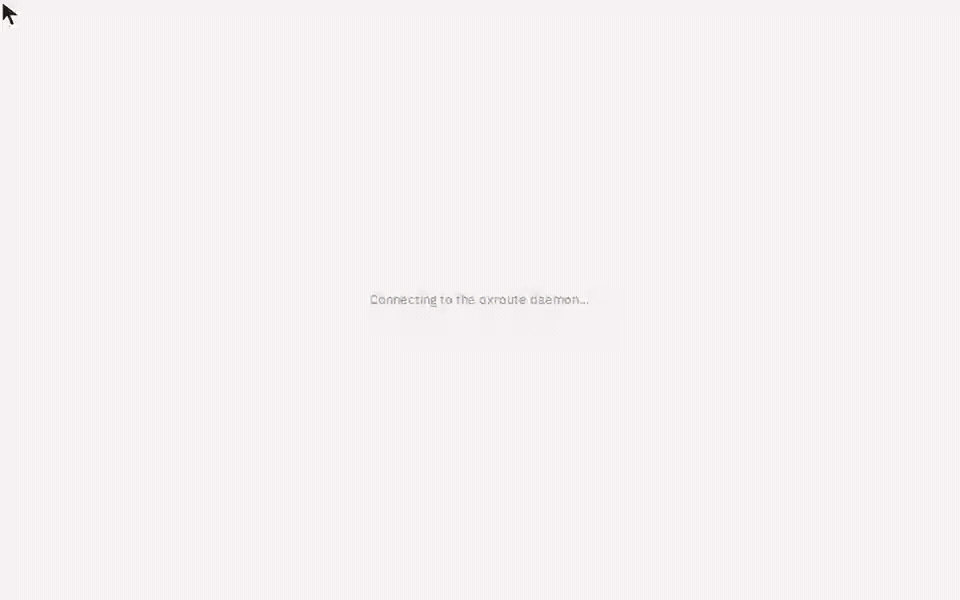

# oxroute

Everything asking for your attention in one inbox, sorted into agents that
do the work while you watch.

[](demo/demo.mp4)

*[The video](demo/demo.mp4) opens with selecting code and quoting the diff into
chat, followed by resizable panes, shared terminals, inbox routing, tasks,
and diagrams. Refresh with [demo/run.sh](demo/run.sh).
The inbox take uses [demo/oxroute.oxd](demo/oxroute.oxd); the new feature take
uses the current UI with isolated [fixture data](demo/record-features.mjs).*

The original inbox take can be recorded again with [demo/record-inbox.sh](demo/record-inbox.sh).

| | |
|---|---|
| **Inbox** | Slack, email or anything that can POST waits in one place until you say where it goes |
| **Routing** | Send a request to a new session, to one already running, or throw it away |
| **Fleet** | Every session on one screen, with what it is doing now and what it just said |
| **Panes** | Arrange conversations and terminals, resize shared edges, or collapse a pane to its handle. Drag handles and tabs between Oxroute windows, onto pane edges, or onto the tab bar; drag outside to detach, or right-click **Move to new window**. Drafts and attachments move with the pane |
| **Terminals** | Agents can open two panes per conversation; access to another terminal requires your consent |
| **Tasks** | A shared list the agents work through: they mark a task done, you approve it or send it back |
| **Corrections** | "Not yet" puts the task above the composer, so what is wrong is said with room and pictures |
| **Diagram** | Draw a change to the architecture diagram and the agent makes the code match it |
| **Drawing** | Mark up a screenshot and hand that to the agent, or file it as work |
| **Search** | Find the session by a line someone said in it, across oxroute's sessions and the harnesses' own |
| **Forks** | Branch a session into this card or one beside it, and merge it back when it is done |
| **Quoted threads** | Select text to open a linked discussion; click its underline to return, then merge or archive it |
| **Harnesses** | Claude Code and Codex, behind one interface |
| **Surfaces** | A web UI, a terminal UI and Slack, all on the same sessions |
| **Settings** | Automatic card titles and tags, subtle or stacked next-action suggestions, light or dark, pane scale, tool-call detail and keyboard hints |
| **Change review** | Syntax colors and changed-word highlights; quote diff lines and approve the exact revision before publication |

Right-click a task's **Approve** button and choose **Approve all subtasks** to
approve that task and every nested subtask, including unfinished tasks and tasks
hidden by search. This is one atomic human sign-off with a note on each changed
task. Ordinary clicks approve only the selected task. Unrelated tasks and
publication approvals are unchanged.

## Card automation

Open the gear icon for two independent server-wide settings:

- **Automatic card titles** starts on. Luna names new cards until you explicitly rename them. Existing titles are preserved because older records do not distinguish chosen titles from generated ones.
- **Automatic card tags** starts off. When enabled, Luna adds topic tags after turns, preserves existing tags and remembers tags you remove. It cannot replace keyed tags such as workflow stages or publication policy.

Metadata uses `gpt-6-luna` by default. An explicit `OXROUTE_TITLE_MODEL` or `[codex].title_model` overrides the helper model. Conversation and routing models keep their existing configuration.

**Next-action layout** is a browser preference in the same settings menu. Suggestions default to subtle inline choices; select **Stacked** for larger choices with descriptions. The Play dropdown independently controls whether next actions are suggested, and its main control governs automatic continuation.

## Agent CLI

`oxroute-agent` discovers named commands and request flags from
`/api/agent-openapi.json`. The same handler annotations register the daemon's
routes and generate that schema, so the client has no separate endpoint table.
The existing HTTP API and TUI remain available.

```sh
oxroute-agent --agent agent_ID tasks list --filter status=incomplete --fields id,text,status
oxroute-agent --agent agent_ID tasks update --id task_ID --status done --note 'Implemented and tested.'
oxroute-agent --agent agent_ID notes list --filter taskId=task_ID
oxroute-agent --agent agent_ID tags change --set '["stage:testing"]'
oxroute-agent --agent agent_ID reviews show --review review_ID --full true
```

Commands cover tasks, notes, tags, boards, review creation and reading, session
reading, and state. Use generated `--help` for each command. `--agent` binds the
calling session; `OXROUTE_AGENT_ID` can supply it instead. Task lists show that
session's tasks unless `--all` is supplied. `--fields` projects JSON output and
repeatable `--filter field=value` filters returned objects. Dotted fields such as
`snapshot.headCommit` return only that value under the requested dotted key.

Task updates preserve omitted fields, clearing an obsolete blocker when leaving
the blocked state. Human task sign-off and publication approval keep their
existing UI controls and HTTP routes; they are not generated agent approval
commands. `--json` accepts an object or `@path`; `--server` selects the daemon,
and `--schema path` uses an explicitly exported OpenAPI document. The installer
and idle release flow install the client alongside the daemon.

## Review before publication

The agent commits its proposed change locally, then POSTs to
`/api/agents/<agent-id>/reviews` with `repository` (absolute worktree root),
`base` (existing target branch), `remote`, `title`, and `description`.
Oxroute stores the committed diff and adds a review card to that conversation.
There is no VM repository discovery or push during review.

Open the card to browse files. Additions are green, deletions red. Select lines
and right-click to quote their review ID, fixed commits, file, and line ranges
into a question. The checkmark approves publication of that revision and queues
the authorization to the owning agent without interrupting its current turn.
Approval does not authorize merging or deploying.

Follow-up reviews on the same publication target start with changes since the
last approved revision. Click **Since approval** to switch to the **Full PR**
view, or click it again to return. Quotes and image previews use the displayed
comparison. Approval still binds the reviewed merge base, head, target branch,
and remote; changing views never grants approval.

PNG, JPEG, GIF, WebP, SVG, AVIF, BMP and ICO files show before-and-after previews,
including added and deleted images. Click a preview to open it at full size.
Images load on demand from the reviewed Git revisions; SVG source diffs remain
available below their previews.

Markdown images and file links beneath the configured artifact directory are
served through the daemon, including links in previously saved replies. The
file route preserves streaming and range requests and resolves paths within
that artifact directory.

Explicit user approval in Slack or chat is equivalent to approval on the review
card. After presenting the exact committed change, the agent can push it and
create its PR even if the card remains pending. Record the user's approval in
a task note; do not ask for a card click or call the approval endpoint.

Before pushing, read `/api/agents/<agent-id>/reviews/<review-id>` to verify that
the reviewed change is current. A stale review requires new approval; a pending
review with explicit chat approval is ready to publish. Publish the recorded
head commit to the recorded remote and branch, using the stored PR title and
description. Approval does not authorize merging or deployment. Changes to the reviewed
head, merge base, branch, destination, or tracked edits make the review stale and
require a new review. Unrelated target-branch updates keep approval available when
the PR comparison is unchanged. Stored diffs survive those changes and restarts.

This is a consent workflow in a single-user app. It does not sandbox an agent's
shell or intercept arbitrary Git commands. Approval is a user action; agents
must never call the approval endpoint themselves.

Failed browser API requests retain diagnostic metadata across reloads and upload it
when connectivity returns. `GET /api/client-failures` returns the latest 100 reports
with time, conversation, request ID, endpoint, status, error and frontend version.
Reports exclude submitted message text and file contents.

Pane forks keep their layout beside the parent and open independent Slack threads.
Existing pane forks without a thread connect on their next message. Slack outages
do not prevent pane creation. Quoted discussions retain their anchors and also
receive Slack threads. A periodic reconciliation repairs missing Codex thread
bindings without starting or interrupting model turns.

After pushing a PR branch, the agent registers `POST /api/agents/<agent-id>/merge-watches`
with `repository`, `remote` and `branch`. Registration verifies the remote head and
is idempotent. An optional `pullRequest` HTTPS URL also supports cross-repository
PRs; register again when that URL becomes available. The agent's turn instructions
include this step for both reviewed and direct publication.

The daemon persists watches, discovers PRs for the published branch and commit,
and checks merge status every five minutes without model calls. It uses existing
`gh`/`glab` authentication; GitHub also supports `GH_TOKEN` or `GITHUB_TOKEN` when
`gh` is unavailable, and public repositories can use unauthenticated reads. Failed
checks stay pending with their diagnostic in `GET /api/agents/<agent-id>/merge-watches`.
A confirmed merge queues a system turn in the owning conversation after active
work finishes. The delivery receipt is saved when the harness accepts the turn;
subsequent checks and restarts skip delivered events. A process failure between
harness acceptance and receipt persistence can redeliver the event. Closed,
unmerged PRs never trigger a merge notification. Notifications grant no new
publication or deployment permission.
